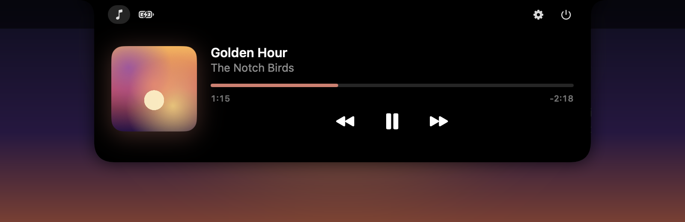
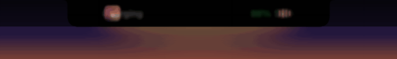

<p align="center">
  
</p>

<h1 align="center">Perch</h1>

<p align="center">
  <b>A Dynamic Island for the Mac notch. Free, open source, and light enough to forget it is running.</b>
</p>

<p align="center">
  <a href="https://github.com/DmanOnline/perch/actions/workflows/ci.yml"></a>
  
  
  <a href="LICENSE"></a>
</p>

---

The notch on your MacBook is a hole in the screen. Perch turns it into a living part of it: music, charging and whatever else matters right now grow out of the notch, the way the Dynamic Island does on iPhone, and fold back in when you are done.

<p align="center">
  
</p>

## What it does

**Lives in the notch.** When nothing is happening, Perch is invisible. When something is, it slides out of the notch on both sides, and slides back under it when it is over. Rest the pointer on it or click it to open the full view.

**Music from any app.** Spotify, Apple Music, a YouTube tab: whatever reports to Now Playing shows up with its artwork and an equalizer tinted in the artwork's colour. Open the notch for title, a seekable progress bar and controls. Click the artwork to jump to the app.

<p align="center">
  
</p>

**Charging, celebrated.** Plug in and the notch shows the charge level while pulses of energy flow into the battery, each one felt as a tap on the trackpad.

**Feels like hardware.** Springs tuned to land without wobble, a tap on the trackpad when you reach the notch and a firmer one when it opens. The notch stays perfectly still when you swipe between desktops, and comes back after sleep, display changes and full-screen apps.

**Yours to tune.** Hover or click to open, how long to wait, how strong the haptics are, which screens get a notch, and which modules run.

<p align="center">
  
</p>

## Built to stay out of the way

| | Perch |
|---|---|
| CPU at rest | 0% |
| CPU while music plays | under 2% |
| Memory | about 20 MB |
| Dependencies | none (one vendored BSD-3 helper, built from source) |
| Telemetry | none |

## Install

Perch is young. Signed releases and a Homebrew cask arrive with 0.2. Until then, build it yourself in a few minutes:

```bash
brew install xcodegen
git clone https://github.com/DmanOnline/perch.git
cd perch
xcodegen generate
open Perch.xcodeproj
```

Press Run in Xcode. You need Xcode 26 or later and a Mac on macOS 15 Sequoia or later. Macs without a notch get a virtual one at the top of the screen.

## How it works

Everything in the notch is a **module**: music and battery today, more to come. Each module says what it wants to show and how important it is right now; a small arbiter decides who gets the notch. Modules bring their own compact view, full view and settings, which is also how outside extensions will plug in later.

- **Now Playing** comes from macOS's private MediaRemote framework. Since macOS 15.4 only Apple's own processes may read it, so Perch runs a small helper under `/usr/bin/perl`, which is allowed, through [mediaremote-adapter](https://github.com/ungive/mediaremote-adapter). The helper is vendored as source and built by Xcode, so no prebuilt binaries live in this repository.
- **The notch window** sits in its own window-server space above every desktop, which is why it does not slide along when you change desktops.
- **Animations** run on Core Animation and SwiftUI springs, and Perch does no work while nothing changes.

The full plan, including what is coming and why, is in [docs/PLAN.md](docs/PLAN.md).

## Roadmap

| Version | Focus | Status |
|---|---|---|
| 0.1 | The foundation: notch window, music, battery, settings, CI | In progress |
| 0.2 | Claude Code module (which sessions work, which wait for you), always-visible peek, signed release, Homebrew | Planned |
| 0.3 | Volume and brightness HUD, Bluetooth, calendar, file shelf with AirDrop | Planned |
| 0.4 | Extensions from other developers, mirrored notifications, Liquid Glass | Planned |

## Contributing

Issues and pull requests are welcome. Perch aims to stay small, fast and native: one clear idea per pull request, tests for logic, and a screenshot or GIF for anything you can see. Run the tests with `xcodebuild test -scheme Perch` after `xcodegen generate`.

## Thanks

- [mediaremote-adapter](https://github.com/ungive/mediaremote-adapter) by Jonas van den Berg (BSD 3-Clause), for reading what is playing.
- [boring.notch](https://github.com/TheBoredTeam/boring.notch) by TheBoredTeam, whose motion Perch is tuned against.
- [DynamicNotchKit](https://github.com/MrKai77/DynamicNotchKit) by Kai Azim (MIT), for the shape of the notch.

## License

Perch is free software under the [GNU General Public License v3.0](LICENSE). You may use, study, share and change it.
