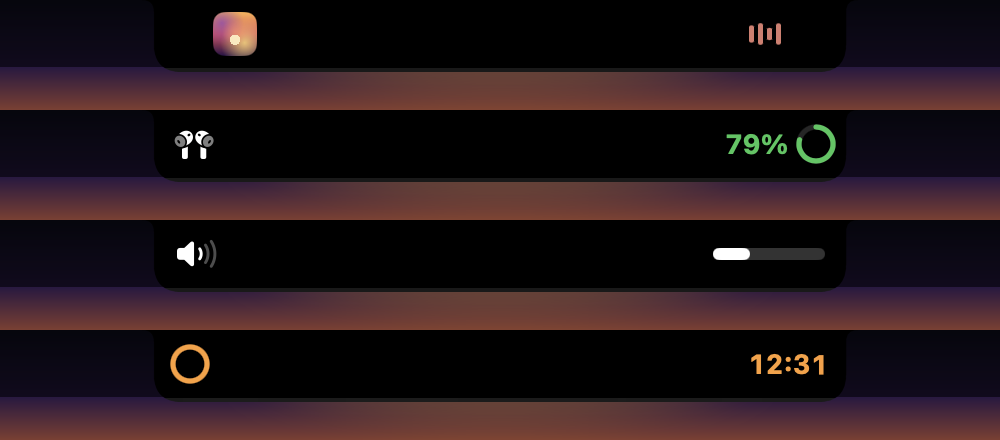
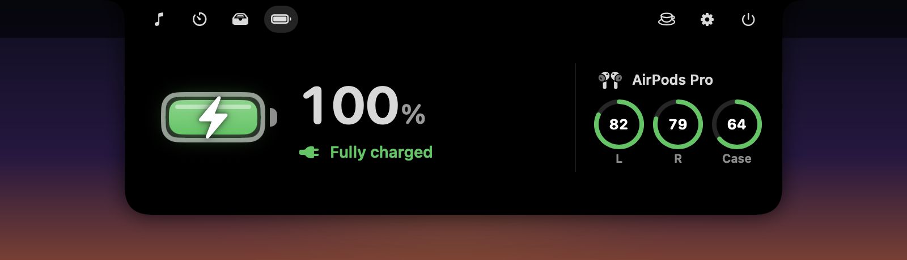
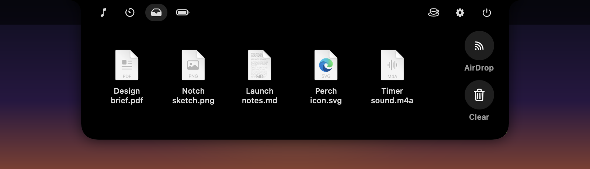
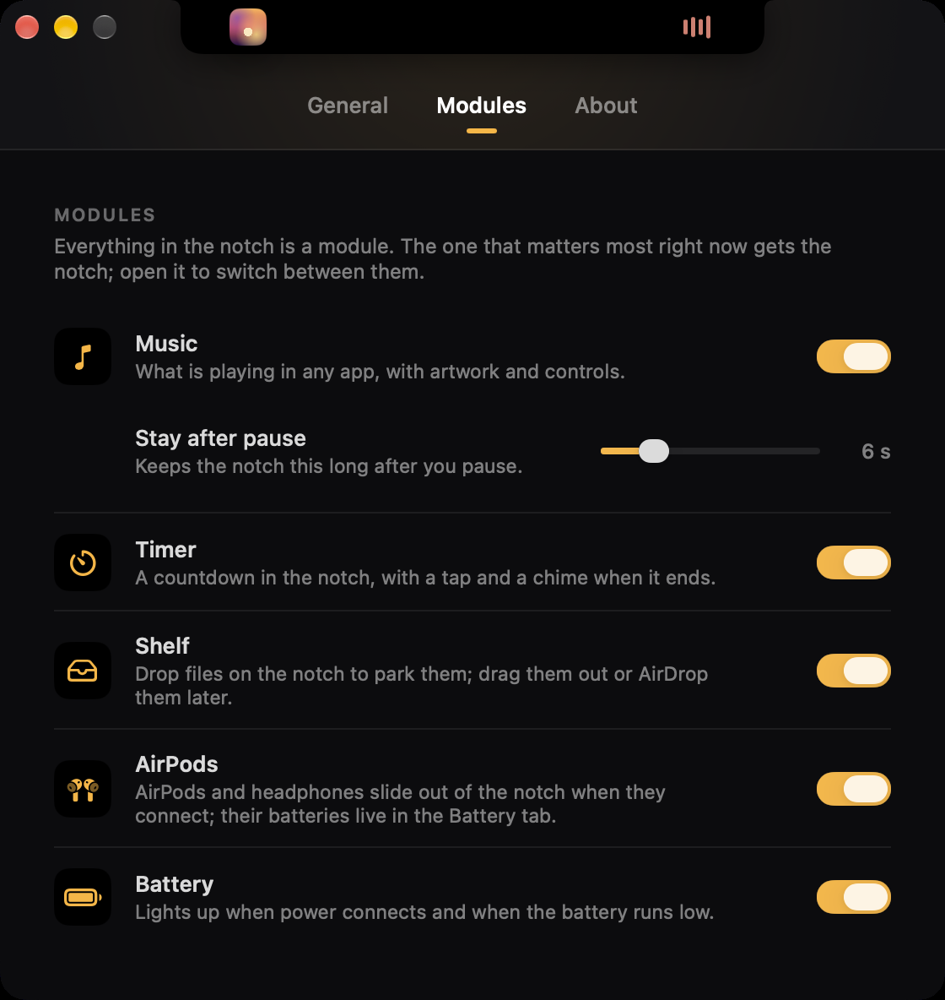

<p align="center">
  
</p>

<h1 align="center">Perch</h1>

<p align="center">
  <b>A Dynamic Island for the Mac notch. Free, open source, and light enough to forget it is running.</b>
</p>

<p align="center">
  <a href="https://github.com/DmanOnline/perch/actions/workflows/ci.yml"></a>
  
  
  <a href="LICENSE"></a>
</p>

---

The notch on your MacBook is a hole in the screen. Perch turns it into a living part of it: music, charging, your AirPods, a timer, volume and brightness grow out of the notch the way the Dynamic Island does on iPhone, and fold back in when you are done.

<p align="center">
  
</p>

## What it does

**Lives in the notch.** When nothing is happening, Perch is invisible. When something is, it slides out of the notch on both sides, and slides back under it when it is over. Rest the pointer on it or click it to open the full view.

<p align="center">
  
</p>

**Music from any app.** Spotify, Apple Music, a YouTube tab: whatever reports to Now Playing shows up with its artwork and an equalizer tinted in the artwork's colour. Open the notch for title, a seekable progress bar and controls. Click the artwork to jump to the app.

<p align="center">
  
</p>

**Charging, celebrated.** Plug in and the notch shows the charge level while pulses of energy flow into the battery, each one felt as a tap on the trackpad.

**Your AirPods, like on iPhone.** Take them out of the case and they slide out of the notch with their battery. The Battery tab shows your Mac and each bud and the case, with which one is charging.

<p align="center">
  
</p>

**Volume and brightness, out of the notch.** Press the keys and a slim slider slides out of the notch instead of the grey box in the middle of your screen. Hover over it to drag. It even shows over a full-screen video.

**A timer that rings.** Pick a preset or dial in minutes; the countdown sits in the notch, and when it ends you hear the familiar timer sound until you stop it.

**A shelf for files.** Drag files onto the notch to park them there, then drag them out where you need them or send them all with AirDrop.

<p align="center">
  
</p>

**Keep awake.** One click on the cup keeps your Mac awake, until you turn it off or for 30 minutes to 2 hours.

**A mirror at the camera.** The Mirror tab shows your camera, mirrored, for a look before a call. The camera runs only while you look.

**Gestures.** Two fingers on the trackpad over the notch: down opens, up closes, sideways skips a track while music plays and changes tab otherwise, and up and down on the volume pop-up sets the volume.

**Black or glass.** Keep the open notch solid black like the notch itself, or switch it to Liquid Glass that fades into black where it meets the notch.

**Feels like hardware.** Springs tuned to land without wobble, a tap on the trackpad when you reach the notch and a firmer one when it opens. The notch stays perfectly still when you swipe between desktops, comes back after sleep and display changes, and steps aside while you watch a video in full screen.

**Yours to tune.** Hover or click to open, how long to wait, how strong the haptics are, which screens get a notch, which modules run, and whether music or your battery stays beside the notch when nothing is happening.

<p align="center">
  
</p>

## Built to stay out of the way

| | Perch |
|---|---|
| CPU at rest | 0% |
| CPU while music plays | under 2% |
| Memory | about 20 MB |
| Dependencies | Sparkle for updates; one vendored BSD-3 helper, built from source |
| Telemetry | none |
| Permissions | none required; Accessibility only if you want Perch to replace the volume and brightness pop-up |

## Install

**With Homebrew**

```bash
brew tap dmanonline/perch
brew trust dmanonline/perch
brew install --cask perch
```

**Or download** `Perch.dmg` from the [latest release](https://github.com/DmanOnline/perch/releases/latest) and drag Perch to Applications.

Perch is signed but not notarized by Apple, so the first time macOS may refuse to open it. Open **System Settings › Privacy & Security** and click **Open Anyway** next to Perch. After that it opens normally and keeps itself up to date.

You need a Mac on macOS 15 Sequoia or later. Macs without a notch get a virtual one at the top of the screen.

**Build it yourself**

```bash
brew install xcodegen
git clone https://github.com/DmanOnline/perch.git
cd perch
xcodegen generate
open Perch.xcodeproj
```

Press Run in Xcode 26 or later.

## How it works

Everything in the notch is a **module**: music, timer, shelf, battery, AirPods, volume and brightness. Each module says what it wants to show and how important it is right now; a small arbiter decides who gets the notch. Modules bring their own compact view, full view and settings, which is also how outside extensions will plug in later.

- **Now Playing** comes from macOS's private MediaRemote framework. Since macOS 15.4 only Apple's own processes may read it, so Perch runs a small helper under `/usr/bin/perl`, which is allowed, through [mediaremote-adapter](https://github.com/ungive/mediaremote-adapter). The helper is vendored as source and built by Xcode, so no prebuilt binaries live in this repository.
- **Batteries** of AirPods and other accessories come from the same power sources macOS's Batteries widget reads, so Perch knows exactly which bud is charging.
- **Volume and brightness keys** are caught with an event tap (with your permission) so macOS's own pop-up stays away; brightness goes through the DisplayServices framework that Control Center uses.
- **The notch window** sits in its own window-server space above every desktop, which is why it does not slide along when you change desktops.
- **Animations** run on Core Animation and SwiftUI springs, and Perch does no work while nothing changes.
- **Updates** come through [Sparkle](https://sparkle-project.org): Perch installs only releases signed with its own key.

The full plan, including what is coming and why, is in [docs/PLAN.md](docs/PLAN.md).

## Roadmap

| Version | Focus | Status |
|---|---|---|
| 0.1 | The foundation: notch window, music, battery, settings | Done |
| 0.2 | Dynamic Island moments: AirPods, timer, volume and brightness, shelf, keep awake, sneak peek; signed releases, updates, Homebrew | Done |
| 0.3 | Trackpad gestures, mirror, Liquid Glass | Done |
| 0.4 | Coding agents in the notch (Claude Code sessions, answer permission prompts), calendar with join buttons | Next |
| Later | Mirrored notifications, extensions from other developers | Planned |

## Contributing

Issues and pull requests are welcome. Perch aims to stay small, fast and native: one clear idea per pull request, tests for logic, and a screenshot or GIF for anything you can see. Run the tests with `xcodebuild test -scheme Perch` after `xcodegen generate`.

## Thanks

- [mediaremote-adapter](https://github.com/ungive/mediaremote-adapter) by Jonas van den Berg (BSD 3-Clause), for reading what is playing.
- [boring.notch](https://github.com/TheBoredTeam/boring.notch) by TheBoredTeam, whose motion Perch is tuned against.
- [DynamicNotchKit](https://github.com/MrKai77/DynamicNotchKit) by Kai Azim (MIT), for the shape of the notch.
- [Sparkle](https://sparkle-project.org) (MIT), for updates.
- [SkyLightWindow](https://github.com/Lakr233/SkyLightWindow) by Lakr233 (MIT), for how to stay above every desktop and the lock screen.

## License

Perch is free software under the [GNU General Public License v3.0](LICENSE). You may use, study, share and change it.
